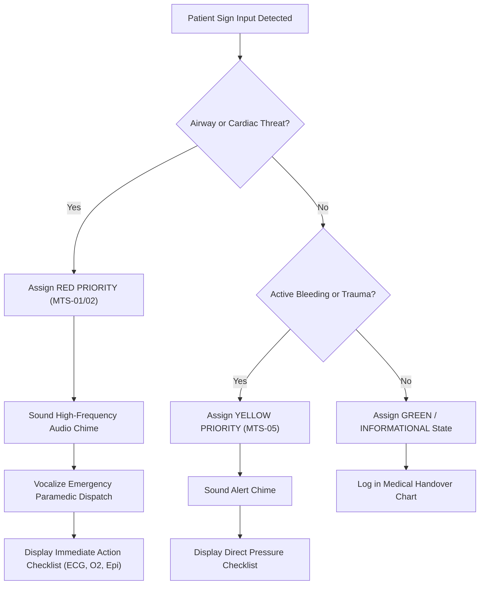

# VoxGesture: Clinical Emergency Triage Protocol (MTS Integration)

> **Infomatrix Software Development Category (Category 01)**  
> **Clinical Standard**: Manchester Triage System (MTS) & Emergency Severity Index (ESI)  
> **Target Criterion**: **07 Documentation (5/5)**

---

## 1. Clinical Context & Triage Prioritization

In emergency medicine, triage is the formal process of rapidly categorizing patients based on the acuity of their clinical presentation to ensure that life-threatening conditions receive immediate intervention.

The **Manchester Triage System (MTS)** is the gold standard utilized across emergency departments in Europe and internationally, defining 5 discrete priority levels:

| Priority Level | MTS Color Code | Maximum Target Response Time | VoxGesture Emergency Sign Alignment |
| :---: | :---: | :---: | :--- |
| **1** | 🚨 **RED (Immediate / Resuscitation)** | **0 Minutes** (Immediate life threat) | `GEST_CHEST_PAIN`, `GEST_CHOKING`, `GEST_ALLERGY` |
| **2** | ⚠️ **ORANGE / YELLOW (Very Urgent)** | **10 Minutes** (Potential life/limb threat) | `GEST_BLEEDING`, `GEST_DIZZINESS`, `GEST_NEED_HELP` |
| **3** | 🟢 **GREEN (Urgent / Standard)** | **60 Minutes** (Stable condition) | Positive confirmations / routine history |
| **4** | 🔵 **BLUE (Non-Urgent)** | **120 Minutes** (Minor acute symptoms) | Negations / administrative questions |

---

## 2. Decision Tree & Triage Action Protocols

---

## 3. Hospital Handover Record Specification

When an ambulance transports a patient to the emergency room, verbal and electronic handover must be seamless. VoxGesture compiles an auditable JSON and printable medical handover record containing:
- Initial symptom detection timestamp (exact down to seconds).
- MTS priority code and continuous confidence rating.
- Paramedic questions asked and confirmed patient responses.
- Timeline of vital symptom progression.
